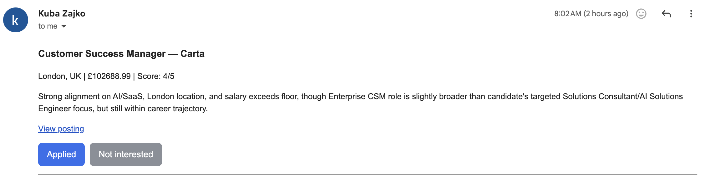
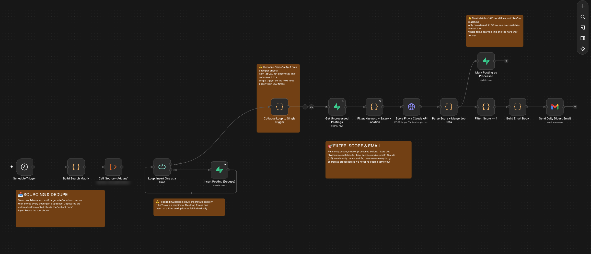

# job-search-orchestrator-n8n

A daily n8n pipeline that pulls job postings from an aggregator API, dedupes them in Supabase, filters out obvious mismatches with plain code, and pays Claude to score only what is left. The strong matches arrive as an email at 08:00, each with **Applied** and **Not interested** buttons. Clicking Applied adds the role to my Notion job pipeline with Stage: Applied, so tracking starts the moment I apply.

Built in one working session in n8n Cloud as a tool for my own job search, then run on a schedule. v2 added the feedback buttons and the Notion hand-off.

---

## The problem

Finding roles at scale is mostly reading postings that were never a fit. The obvious automation, an LLM crawling job sites, is expensive: every page costs tokens, most of them spent on postings a simple keyword check would have rejected. LinkedIn and most job boards also don't offer an open API for pulling postings.

The answer here is to give each tool the step it does best:

- **Collection:** aggregator APIs (Adzuna to start), which return structured JSON for free.
- **Dedupe:** the database, through a unique constraint.
- **Obvious mismatches:** plain code (title keywords, exclusions, salary floor, location).
- **Judgement:** an LLM, but only on the few percent that survive.

**Design rule:** the LLM never sees a posting that a string check could have rejected.

---

## What it produces

The daily digest from a real run, with one block per posting scored 4 or 5:



The n8n canvas, with sticky notes marking each stage:



---

## How it works

```
Schedule 08:00
   → Build search matrix (8 role × location pairs)
   → Source - Adzuna sub-workflow (API call → split → normalise)
   → Insert one at a time into Supabase (unique source + external_id)
   → Get postings where emailed = false
   → Filter: keyword + salary + location (code, no tokens)
   → Score fit with Claude Haiku 4.5 (1–5 + one-line reason)
        ├→ Mark every scored posting as processed (+ store score and reason)
        └→ Keep scores ≥ 4 → sign links → build HTML with buttons → Gmail digest

Click "Applied" or "Not interested" in the email  (Feedback workflow)
   → GET  /webhook/job-feedback          check token → show Confirm page (changes nothing)
   → POST /webhook/job-feedback-confirm  check token → skip if already marked
        ├→ Applied:        create Notion Job Pipeline page (Stage: Applied) → status = applied
        └→ Not interested: status = not_interested
```

Each aggregator is its own sub-workflow with the same output shape, so adding a source means one new workflow and one call node. The orchestrator doesn't change.

| Stage | Node | What it does |
|---|---|---|
| Trigger | Schedule Trigger | Runs daily at 08:00 |
| Sourcing | Build Search Matrix | Emits 8 `{searchTerm, location}` pairs |
| Sourcing | Call 'Source - Adzuna' | Runs the sub-workflow once per pair: API call, split results, normalise fields |
| Dedupe | Loop: Insert One at a Time → Insert Posting (Dedupe) | One insert per row, so a duplicate fails on its own and is skipped |
| Dedupe | Collapse Loop to Single Trigger | Turns the loop's per-item `done` output into one trigger |
| Select | Get Unprocessed Postings | Rows where `emailed = false` |
| Filter | Filter: Keyword + Salary + Location | Deterministic checks, no tokens |
| Score | Score Fit via Claude API | Haiku 4.5 returns `{score, reasoning}` as JSON |
| Score | Parse Score + Merge Job Data | Strips code fences, parses JSON, rejoins the posting fields |
| State | Mark Posting as Processed | Sets `emailed = true` on everything scored, and stores `fit_score` / `fit_reasoning` |
| Output | Filter: Score >= 4 → Sign Feedback Links | Adds a token to each posting: SHA-256 of a secret + `source` + `external_id` |
| Output | Build Email Body → Send Daily Digest Email | HTML digest of the 4s and 5s, with Applied / Not interested buttons |

**The feedback workflow** (`workflows/job-sourcing-feedback.json`) handles the buttons:

| Stage | Node | What it does |
|---|---|---|
| Click | Link Clicked (GET) → Normalise Link → Get Posting → Valid Link? | Recomputes the token, checks the action and that the posting exists |
| Click | Show Confirmation Page / Reject Invalid Link | A page naming the role with a Confirm button, or a 403 |
| Confirm | Confirm Submitted (POST) → Normalise Confirm → Get Posting for Update → Valid Request? | The same checks again on the submitted form |
| Confirm | Already Marked? | If `status` is already set, says so and changes nothing |
| Confirm | Applied? → Add to Notion Job Pipeline → Mark as Applied | Creates the Notion page, then sets `status = applied` |
| Confirm | Mark as Not Interested | Sets `status = not_interested` |

**What lands in Notion** when Applied is confirmed:

| Notion property | Value |
|---|---|
| Company (title) | `company` |
| Role | `title` |
| Stage | Applied |
| Decision | Pending |
| Application link | `url` |
| Salary range | `salary_min` – `salary_max` |
| Fit rationale | "Auto-score 4/5: " + Claude's one-line reason |
| Last contact date | the day you clicked |

The page body gets an Overview, the job description and a link to the posting.

**The normalised posting** every source sub-workflow returns:

| Field | Adzuna source |
|---|---|
| `title` | `title` |
| `company` | `company.display_name` |
| `location` | `location.display_name` |
| `url` | `redirect_url` |
| `salary_min` / `salary_max` | `salary_min` / `salary_max` |
| `source` | `"adzuna"` (fixed) |
| `external_id` | `id` |
| `posted_date` | `created` |
| `description` | `description` |

**The free filter:**

| Check | Rule |
|---|---|
| Target title | Contains one of: solutions consultant, solutions engineer, AI solutions engineer, business automation, enterprise CSM, customer success manager, presales / pre-sales consultant, adoption strategist |
| Excluded title | Contains none of: junior, graduate, intern, apprentice |
| Salary | `salary_max` ≥ £75,000 |
| Location | Contains london, remote or uk |

---

## Results

From the first full run:

| Stage | Postings |
|---|---|
| Fetched from Adzuna (8 searches × up to 50) | 350 |
| Unique after dedupe | 323 |
| Passed the free filter | 22 |
| Scored 4 or 5 and emailed | 15 |

| Metric | Value |
|---|---|
| Share of fetched postings that reach the LLM | ~7% |
| LLM calls per run | one per filter survivor (22 here) |
| Model | Claude Haiku 4.5 ($1 / $5 per million input / output tokens) |
| Scoring cost per run | a few pence at most |

On later days the dedupe and the `emailed` flag mean only new postings are scored, so the LLM workload shrinks to that day's genuinely new survivors.

---

## Where it went wrong

Two mistakes were caught by checking real row counts, not by n8n reporting an error:

- **The update hit the whole table.** "Mark Posting as Processed" first matched on `external_id` **or** `source` (Must Match: Any). Since every row has `source = adzuna`, it reported updating 7,403 items for 22 inputs. Switching to Must Match: All fixed it.
- **The loop fired 350 times.** The Loop node's `done` output emits once per original item, not once in total, so everything downstream ran 350 times over the same data. A one-line Code node (`return [{ json: {} }]`) collapses it to a single trigger.

Neither showed up as a failed node. Both looked like success until the numbers were checked against Supabase.

One design problem was caught before it shipped:

- **A plain link would have marked roles by itself.** Email security scanners and link previews open every link in a message. If "Applied" were a simple GET that changed data, a scanner could add every role in the digest to Notion before I'd read it. So the link only shows a confirmation page, and the change happens on the Confirm button's POST, which scanners don't submit.

---

## Design decisions and trade-offs

- **Free filters before the LLM.** They cut the scoring workload about 15×. The cost is that a good role with an unusual title never gets scored.
- **Dedupe in the database, not in n8n.** A `unique (source, external_id)` constraint holds across runs and sources without any state in the workflow.
- **Mark everything scored as processed**, not only what was emailed. Otherwise rejected postings would be re-scored, and paid for, every morning.
- **One sub-workflow per source.** A fixed output shape keeps the orchestrator unchanged as sources are added.
- **Haiku, not a larger model.** The task is a 1–5 rating with one sentence of reasoning, so a cheap fast model is enough.
- **Notion first, then Supabase.** The Notion page is created before `status = applied` is written. If Notion fails, the posting stays unmarked and the button can be clicked again. The reverse order could mark a role as applied with nothing in Notion.
- **Signed links, not webhook auth.** The webhooks are public URLs, so each link carries a token derived from a secret. A guessed or edited link gets a 403. It's a shared-secret hash rather than a proper HMAC, which is enough for a personal tool.

---

## Error handling

- **Adzuna and Supabase reads** retry 5 times, 5 seconds apart.
- **Duplicate inserts** don't stop the run. The insert node continues on error, so a 409 from the unique constraint skips that posting.
- **Empty filter output** still lets the run continue (Always Output Data on the filter node).
- **LLM output** is parsed defensively: code fences are stripped before `JSON.parse`.
- **Feedback clicks** are idempotent. A second click on either button shows "Already recorded" and creates nothing.
- **Bad or edited links** return a 403 page instead of an error.

---

## Limitations and next steps

- **Adzuna outages fail the whole run.** Adzuna returns intermittent 503s, and the sub-workflow call has no error tolerance, so one outage during the 08:00 run stops it. Next: continue on error at the call node, longer backoff, and a failure alert.
- **Salaries are often Adzuna's estimate**, not the employer's, so the salary floor can wrongly include or exclude roles.
- **Reposts** come back with new IDs and are treated as new. Next: before scoring, drop postings whose company + title matches a row already marked `applied` or `not_interested`.
- **Not interested isn't used yet.** It's recorded, but nothing learns from it. Next: feed those rows back as negative examples in the scoring prompt.
- **Notion only gets the start.** Later stages (interviews, offers) are still updated by hand in Notion.
- **Location matching is a substring check.** "uk" is loose, and the keyword list is hand-maintained.
- **Scores vary slightly between runs**, and the ≥ 4 cut-off is a judgement call, not tuned.
- **One source so far.** Next: add Reed or a similar aggregator as a second sub-workflow.

---

## Setup

1. Create a Supabase project and run `sql/job_postings.sql` in the SQL editor. If you already run v1, run `sql/002_feedback_columns.sql` instead.
2. Get an Adzuna app id and key from developer.adzuna.com.
3. In n8n, import `workflows/source-adzuna.json`, `workflows/job-sourcing-orchestrator.json` and `workflows/job-sourcing-feedback.json`.
4. In the Adzuna HTTP Request node, replace `YOUR_ADZUNA_APP_ID` and `YOUR_ADZUNA_APP_KEY`.
5. Create credentials for Supabase (project URL + service role key), Anthropic API and Gmail OAuth2, and select them on the nodes.
6. In the orchestrator, point **Call 'Source - Adzuna'** at your imported sub-workflow, set the recipient in **Send Daily Digest Email**, and replace `[CANDIDATE PROFILE: …]` in **Score Fit via Claude API**.
7. Adjust the keywords and `salaryFloor` in the filter node.
8. For the feedback buttons:
   - Pick a random secret and replace `YOUR_FEEDBACK_SECRET` in **Sign Feedback Links** (orchestrator) and in **Normalise Link** and **Normalise Confirm** (feedback workflow). All three must match.
   - In **Build Email Body**, replace `YOUR-N8N-HOST` with your n8n host (e.g. `yourname.app.n8n.cloud`).
   - In Notion, create an internal integration, share your job pipeline database with it, and add it in n8n as a Notion API credential. Replace `YOUR_NOTION_DATA_SOURCE_ID` in **Add to Notion Job Pipeline** and check the property names match your database (Company, Role, Stage with an "Applied" option, Decision, Application link, Salary range, Fit rationale, Last contact date).
9. Publish the feedback workflow, then the orchestrator.

`sample-data/postings.sample.json` holds 24 fictional postings in the normalised shape (including duplicates, junior titles, low salaries and off-location roles). You can pin it to the loop input to test the pipeline without calling Adzuna.

---

## How it was built

Built step by step in n8n Cloud: one aggregator working end to end first, then the Supabase store and dedupe, then the free filter, then Claude scoring, then the digest, and then the `emailed` flag so each posting is only scored once. v2 added the feedback workflow, built on top without changing the sourcing or scoring stages. Each stage was checked against real row counts in Supabase before moving on, which is how both mistakes above were found.
